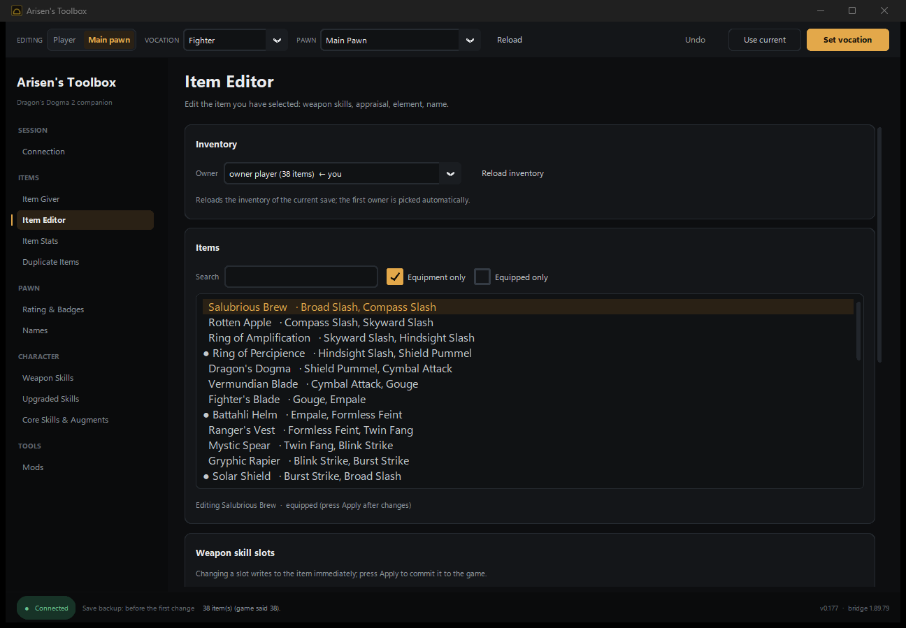

# Arisen's Toolbox

A desktop companion app for **Dragon's Dogma 2** on PC and Steam.

Press **Start** once. It installs REFramework when it is missing, installs or
updates the game-side script, launches the game, and connects when your save
is loaded.



## How it works

The client does not scan memory and does not use AOB patterns. It talks to the
game through a small REFramework Lua script (`bridge/data/ddbridge.lua`). The
two sides exchange plain text files in `reframework/data/ddbridge/`, so game
title updates do not break the connection.

Bulk data (item lists, enums, dumps) travels through sidecar files in the same
folder. The client caches the item list and enum tables, which keeps the Item
Giver usable offline.

## What you can do

| Screen | What it does |
| --- | --- |
| **Connection** | Install/update REFramework and the bridge, launch the game, back up and restore saves, export a diagnostics bundle |
| **Item Giver** | Search every item by name or ID, give it to the inventory or storage, repeat recent gifts |
| **Item Editor** | Edit weapon-skill slots, appraisal, element and item name |
| **Item Stats** | Enhancement, base stats and hidden special effects (the mechanism behind rings) |
| **Duplicate Items** | Copy an inventory entry or double a stack |
| **Rating & Badges** | Pawn rating and badge progress |
| **Names** | Rename the Arisen, the main pawn and hired pawns |
| **Weapon Skills** | Learn or unlearn weapon skills, set levels, and manage six equipped slots per vocation |
| **Upgraded Skills** | Write `JobNN_ExSkill1..5` into the equipped weapon |
| **Core Skills & Augments** | Learn or unlearn passive core skills and fill the six augment slots |
| **Mods** | Jump and fall, movement speed, fast travel, respawn timers, boss summon and nearby-enemy tools |

The target bar at the top selects **Player** or **Main pawn**, the vocation,
and the pawn to edit. Every screen follows that selection.

## Install and run

Requirements: Windows 10/11, Python 3.10 or newer, and
[CustomTkinter](requirements.txt).

```bat
run.bat
```

or, manually:

```bat
python -m pip install -r requirements.txt
python main.py
```

To build a standalone executable:

```bat
build.bat
```

The result is `dist\ArisensToolbox.exe`. The PyInstaller spec bundles
`bridge/data` and the window icon.

The release folder also contains the matching cheat table under `ct/`. Both front-ends embed the same bridge (v1.89.82).

## Safety

Every feature here edits persistent character state, and DD2 saves are
fragile. The client therefore:

- backs the save up automatically before the first change of a session;
- keeps a pinned copy of the very first backup, plus the ten most recent
  ones, under `%LOCALAPPDATA%\ArisensToolbox\backups`;
- records the previous value of most edits, so **Undo** in the top bar can
  revert the last change;
- stops the change if a save folder exists but the backup copy fails;
- clears undo history when the game restarts, because old values belong to
  the old session.

Backups, restores and the diagnostics bundle are on the **Connection** screen.
The game itself is single-player; none of this is meant for online play.

## Keyboard

| Key | Action |
| --- | --- |
| `Ctrl+F` | Jump to Item Giver search |
| `F5` | Refresh the current screen |
| `Ctrl+Z` | Undo the last recorded change (ignored while typing) |
| `Esc` | Close a probe/dump window |

## Project layout

```
main.py                 entry point
version.py              client and bridge versions
ui/app.py               window shell: command bar, navigation, status bar
ui/theme.py             design tokens (colour, type, spacing)
ui/widgets.py           shared components (PageHeader, Section, ListPanel...)
ui/tabs/*.py            one module per screen
bridge/protocol.py      file-based IPC with the game
bridge/installer.py     REFramework download and install
bridge/safety.py        save discovery, backups, diagnostics
bridge/game_path.py     install detection, config locations
bridge/data/ddbridge.lua  game-side script
tests/                  unit, protocol, safety and UI tests
```

## Development

```bat
python -m pip install -r requirements-dev.txt
python -m unittest discover -s tests -v
python deferredcheck.py
```

The UI smoke test opens every tab. It runs wherever Tk can create a window
and skips on headless machines. Set `DD2BRIDGE_DEV=1` (or place a
`dev_mode.txt` next to the app) to show the developer screens and probe
buttons.

Design decisions are documented in [docs/DESIGN.md](docs/DESIGN.md), the
v0.177 review notes in [docs/CODE-REVIEW.md](docs/CODE-REVIEW.md). Release
history lives in [CHANGELOG.md](CHANGELOG.md).

## License

See [LICENSE](LICENSE). This is a fan tool. Dragon's Dogma 2 is a trademark of
Capcom; this project is not affiliated with or endorsed by Capcom.
