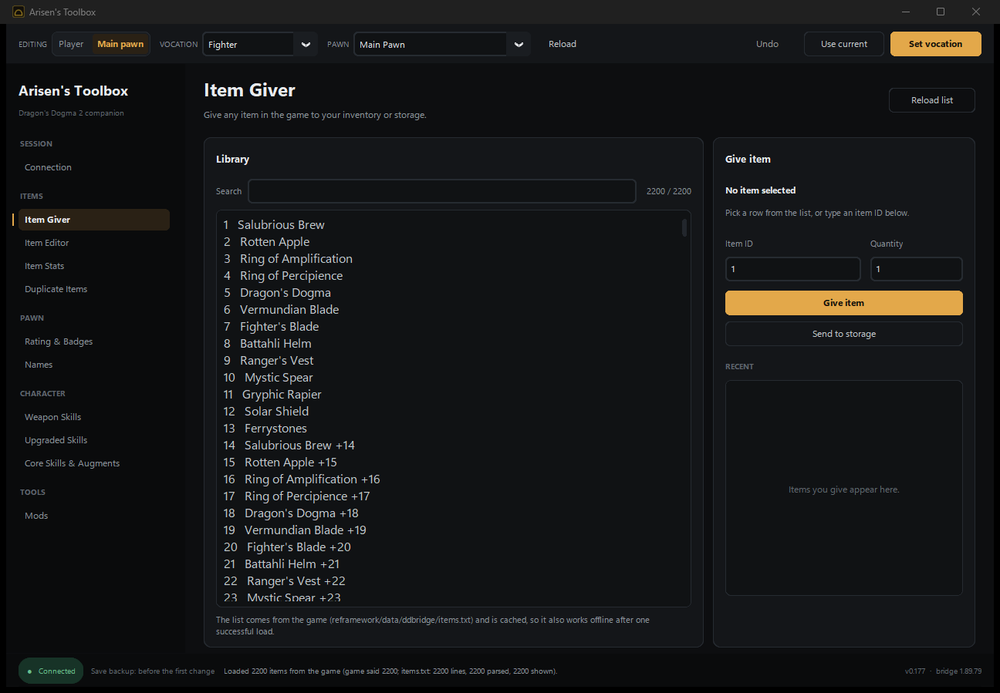
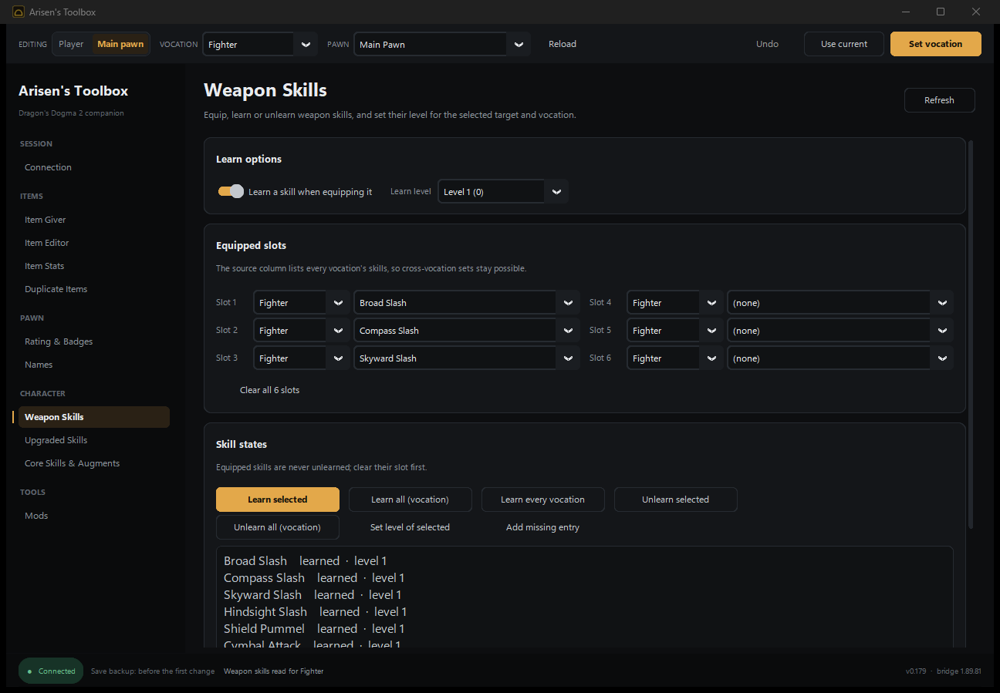
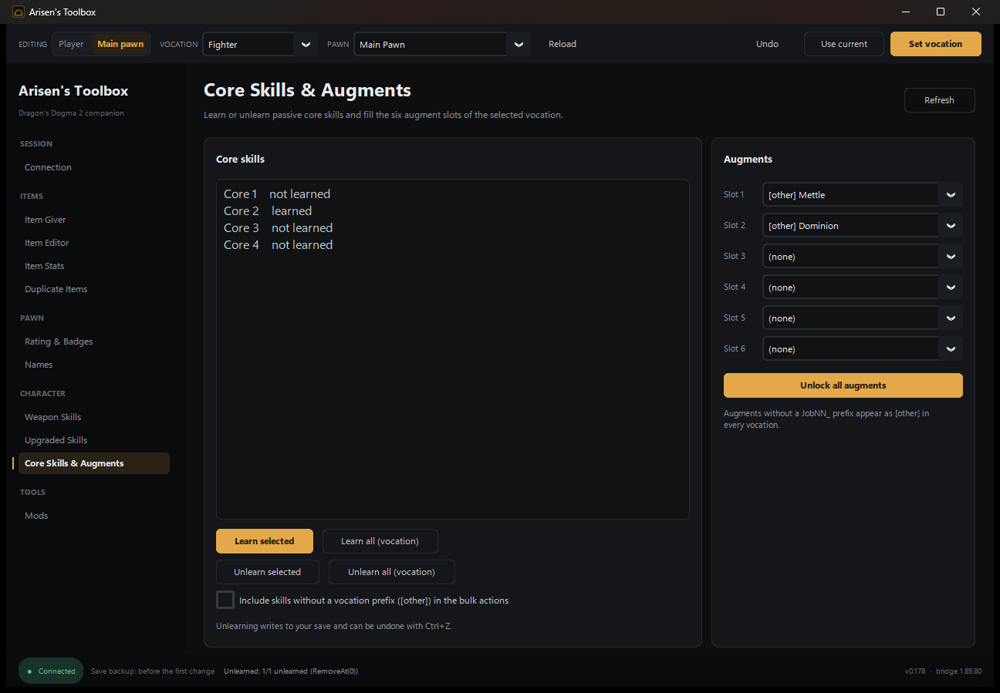

# Arisen's Toolbox — Dragon's Dogma 2 Trainer, Item Editor & Cheat Table

A free Windows companion for **Dragon's Dogma 2** on PC and Steam. Give items, edit gear
and stats, learn or unlearn skills, edit pawns, summon bosses, change movement and fast
travel, and use the matching **Cheat Engine table**. Every edit runs through a small
REFramework Lua bridge, with automatic save backups and undo.

[Download the latest release](https://github.com/Darktenebr01/ArisensToolbox/releases/latest) ·
[Nexus Mods page](https://www.nexusmods.com/dragonsdogma2/mods/1784) ·
[Guides and FAQ](https://darktenebr01.github.io/ArisensToolbox/) ·
[Install guide](https://darktenebr01.github.io/ArisensToolbox/install.html)



## What it does

| Tool | What you can change |
| --- | --- |
| **Item Giver** | Search the game's item library by name or ID, then give an item to inventory or storage |
| **Item Editor** | Weapon-skill slots, appraisal, element, element percentage and a custom item name |
| **Item Stats** | Enhancement level and types, base attack/magick/defence/weight, special-effect IDs and values |
| **Duplicate Items** | Copy an inventory entry or double a stack, optionally carrying skills, enhancement and appraisal |
| **Rating & Badges** | Pawn thumbs-up, hearts and badge progress |
| **Names** | Rename the Arisen, the main pawn and hired pawns |
| **Weapon Skills** | Learn or unlearn weapon skills, set levels, and manage six equipped slots per vocation |
| **Upgraded Skills** | Write `JobNN_ExSkill1..5` into the equipped weapon |
| **Core Skills & Augments** | Learn or unlearn passive core skills and fill the six augment slots |
| **Mods** | Jump height, air time, no fall damage, movement and ladder speed, fast travel, enemy respawn timers, boss summon and nearby-enemy tools |

The top bar selects **Player** or **Main pawn**, the vocation, and the pawn to edit.
Every screen follows that selection.

## Dragon's Dogma 2 cheat table

The release folder also contains a **Cheat Engine table** under `ct/`. It embeds the same
game-side bridge and exposes the pawn, player, skill, item, duplicate, names and mods
tools. Use Cheat Engine 7.x, attach it to `DD2.exe`, tick the panel entry, then press
Connect. See the [cheat table guide](https://darktenebr01.github.io/ArisensToolbox/cheat-table.html).

## Install

Requirements: Windows 10 or 11, Dragon's Dogma 2 on Steam, and a loaded save.

1. Download the release zip from [GitHub Releases](https://github.com/Darktenebr01/ArisensToolbox/releases/latest)
   or the [Nexus page](https://www.nexusmods.com/dragonsdogma2/mods/1784).
2. Extract it to a normal folder, for example `C:\ArisenToolbox`. Do not run the exe from
   inside the zip.
3. Run `ArisensToolbox.exe` and press **Start** on the Connection screen.
4. Load your save, then press **Connect**. The first change in the session creates a backup.

The Connection screen installs REFramework when missing, installs or updates the bridge,
and launches the game through Steam. If SmartScreen warns about the unsigned exe, use
**More info → Run anyway** only when the file came from the official release.

Full instructions and troubleshooting:
[Install guide](https://darktenebr01.github.io/ArisensToolbox/install.html) ·
[FAQ](https://darktenebr01.github.io/ArisensToolbox/faq.html).

## Screenshots

| Item Giver | Weapon Skills | Core Skills & Augments |
| --- | --- | --- |
|  |  |  |

More screenshots and feature guides are on the [website](https://darktenebr01.github.io/ArisensToolbox/).

## How it works

The client does not scan memory and does not use AOB patterns. It talks to the game
through a small REFramework Lua script (`bridge/data/ddbridge.lua`). The two sides
exchange plain text files in `reframework/data/ddbridge/`, so game title updates are less
likely to break the connection than hard-coded memory addresses.

Bulk data such as item lists and enum tables travels through sidecar files in the same
folder. The client caches the item list and enum tables, which keeps the Item Giver
usable offline after one successful load.

## Safety

Every feature edits persistent character state, and DD2 saves are fragile. The client:

- backs up the save automatically before the first change of a session;
- keeps a pinned copy of the first backup plus the ten most recent ones under
  `%LOCALAPPDATA%\ArisensToolbox\backups`;
- records the previous value for most edits, so **Undo** in the top bar can revert the
  last change;
- stops the change if a save folder exists but the backup copy fails;
- clears undo history when the game restarts, because old values belong to the old session.

Backups, restores and the diagnostics bundle are on the **Connection** screen. The game is
single-player; none of this is meant for online play. Back up your save before testing, and
read the [FAQ](https://darktenebr01.github.io/ArisensToolbox/faq.html) for the remaining
limits.

## Keyboard

| Key | Action |
| --- | --- |
| `Ctrl+F` | Jump to Item Giver search |
| `F5` | Refresh the current screen |
| `Ctrl+Z` | Undo the last recorded change (ignored while typing) |
| `Esc` | Close a probe/dump window |

## Development

The source is public for transparency and issue reports. The license is
all-rights-reserved, not an open-source license; redistribution needs permission.

```bat
python -m pip install -r requirements.txt
python main.py
```

Build a standalone exe with `build.bat` (PyInstaller); the result is
`dist\ArisensToolbox.exe` and the matching table is under `ct/`.

Tests and checks:

```bat
python -m pip install -r requirements-dev.txt
python -m unittest discover -s tests -v
python deferredcheck.py
```

The UI smoke test opens every tab and skips on headless machines. Set `DD2BRIDGE_DEV=1`
(or place `dev_mode.txt` next to the app) to show the developer screens and probe buttons.

Design notes are in [docs/DESIGN.md](docs/DESIGN.md), the v0.177 review in
[docs/CODE-REVIEW.md](docs/CODE-REVIEW.md), and release history in
[CHANGELOG.md](CHANGELOG.md).

## Project layout

```
main.py                   entry point
version.py                client and bridge versions
ui/app.py                 window shell: command bar, navigation, status bar
ui/theme.py               design tokens
ui/widgets.py             shared components
ui/tabs/*.py              one module per screen
bridge/protocol.py        file-based IPC with the game
bridge/installer.py       REFramework download and install
bridge/safety.py          save discovery, backups, diagnostics
bridge/game_path.py       install detection, config locations
bridge/data/ddbridge.lua  game-side script
tests/                    unit, protocol, safety and UI tests
docs/                     guides, design notes and the GitHub Pages site
```

## FAQ

**Is it safe?** It edits the loaded save, not a remote account. Save backups and undo are
built in, but any save editor carries risk; keep your own backup.

**Does it work offline?** Yes. The app talks to the game through local files. The item list
is cached after one successful load.

**Will a game update break it?** The file-based bridge is designed to survive updates, but
REFramework and class fields can change. Update REFramework and the bridge from Connection,
then check the release notes.

**Does it work with mods?** It works alongside REFramework mods. Mods that patch the same
game classes can conflict; test on a backed-up save.

**Is there a Cheat Engine table?** Yes, in the release folder. Both front-ends embed the
same bridge.

**Windows only?** Yes. The release targets Windows 10 and 11. Steam Deck/Linux is not a
supported build.

## License

See [LICENSE](LICENSE). This is a fan tool. Dragon's Dogma 2 is a trademark of Capcom;
this project is not affiliated with or endorsed by Capcom.
